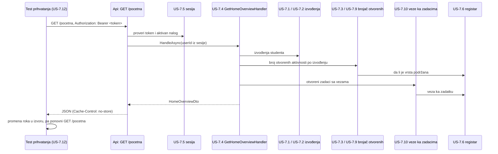

# US-7.12 Aktuelnost podataka i testovi prihvatanja (ST-007, Sprint 2)

Vlasnik proizvoda proverava ceo primer iz specifikacije, kako bi znao da je ST-007 gotov. Testovi rade nad pravim komponentama US-7.1–7.10 (bez mock-ova) i kroz zaštićeni `GET /pocetna`. Podaci su sintetički.

| Kriterijum | Gde je urađeno | Test |
| --- | --- | --- |
| Test: student iz dva predmeta sa jednim otvorenim zadatkom vidi oba predmeta i vezu ka zadatku | `tests/Tests/Acceptance/St007Scenario.cs` (prave komponente početnog pregleda) | `St007AcceptanceTests.StudentIzDvaPredmetaSaJednimOtvorenimZadatkom_VidiObaPredmetaIVezuKaZadatku`, `HomeEndpointAcceptanceTests.Http_StudentIzDvaPredmeta_VidiObaPredmetaIBrojOtvorenihZadataka` |
| Test: promena roka se odmah vidi na početnoj strani | `tests/Tests/Acceptance/MutableActivitySource.cs` (izvor u kom se rok menja) | `St007AcceptanceTests.PromenaRoka_OdmahSeVidiNaPocetnojStrani`, `HomeEndpointAcceptanceTests.Http_PromenaRoka_VidiSeVecPriSledecemZahtevu` |
| Proveriti da nema keša koji prikazuje stare podatke | provera servisa i HTTP odgovora | `St007AcceptanceTests.NemaKesa_SvakiZahtevPonovoCitaIzvorneEvidencije`, `HomeEndpointAcceptanceTests.Http_PocetnaSeNeKesira` |
| Izmeriti vreme odgovora za korisnika sa 10 izvođenja | 10 izvođenja, 50 aktivnosti, 20 merenja posle zagrevanja | `HomeEndpointAcceptanceTests.Http_VremeOdgovora_ZaKorisnikaSa10Izvodjenja` |
| Zapisati rezultate testova u izveštaj sprinta | ovaj dokument, odeljak „Rezultati” | — |

## Tok testa prihvatanja



## Zavisnosti u Sprintu 2

- **Na šta se US-7.12 (Milena) oslanja:** US-7.1 (Mateja), US-7.2 (Marko), US-7.3 i US-7.9 (Svetislav), US-7.4 i US-7.10 (Tamara), US-7.5 i US-7.11 (Dijana), US-7.6 (Milena).
- **Šta se nadovezuje na US-7.12:** ništa; to je završna provera ST-007.

## Pokretanje

```bash
dotnet build Solution.sln
dotnet test Solution.sln --filter "TestCategory=Acceptance" --logger "console;verbosity=detailed"
```

Vreme odgovora ispisuje test `Http_VremeOdgovora_ZaKorisnikaSa10Izvodjenja` (red koji počinje sa `US-7.12 | GET /pocetna`). U Visual Studiju: Test Explorer → taj test → Standard Output.

## Rezultati

| Polje | Vrednost |
| --- | --- |
| Grana i commit | `feature/prikaz-i-provere`, commit `142d28f2` |
| Datum pokretanja | 23.11.2026. |
| Okruženje | Windows, .NET 8, Visual Studio Test Explorer |

| # | Kriterijum | Rezultat |
| --- | --- | --- |
| 1 | Dva predmeta, jedan otvoren zadatak, veza ka zadatku | prošao |
| 2 | Promena roka se odmah vidi | prošao |
| 3 | Nema keša | prošao |
| 4 | Vreme odgovora, 10 izvođenja | medijana 2,2 ms, p95 8,4 ms, max 14,9 ms (20 merenja posle zagrevanja) |

Svi testovi u rešenju (Test Explorer, Run All Tests): svi su prošli, nijedan nije pao.

## Provera keša

- `GetHomeOverviewHandler` (US-7.4), `OpenActivityCounter` (US-7.3, US-7.9) i `OpenTaskLinkReader` (US-7.10) pri svakom zahtevu ponovo čitaju članstva, aktivnosti i predaje; nijedan ne čuva rezultat.
- U `src/Api/Program.cs` nije registrovan `IMemoryCache`, output caching ni response caching.
- `GET /pocetna` vraća `Cache-Control: no-store` (US-7.11) i nema zaglavlja koja dozvoljavaju keširanje (`max-age`, `public`, `ETag`, `Expires`, `Last-Modified`).

## Ograničenja

- Merenje vremena obuhvata ceo HTTP tok u procesu (`WebApplicationFactory`), sa memorijskim adapterima, bez mreže i baze. Posle uvođenja baze merenje treba ponoviti.
- Testovi menjaju opšti rok zadatka. Pojedinačni rok studenta (ST-015) proverava US-7.9.

## Zaključak

Svi testovi prihvatanja ST-007 su prošli nad commitom `142d28f2`. Student iz dva predmeta vidi oba predmeta, broj otvorenih zadataka i vezu ka otvorenom zadatku; promena roka se vidi već pri sledećem zahtevu; odgovor `GET /pocetna` se ne kešira; medijana vremena odgovora za korisnika sa 10 izvođenja je 2,2 ms (p95 8,4 ms). Kriterijumi prihvatanja ST-007 su ispunjeni.
