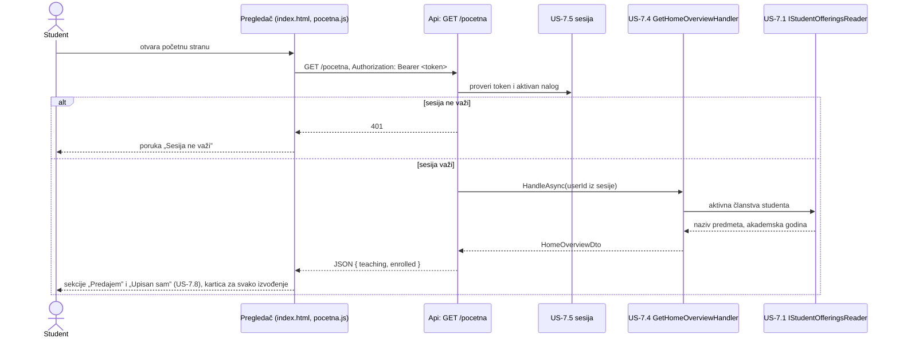

# US-7.7 Kartice izvođenja za studenta (ST-007, Sprint 2)

Student na početnoj strani vidi svoje predmete kao kartice sa nazivom predmeta i akademskom godinom.

| Kriterijum | Gde je urađeno | Test |
| --- | --- | --- |
| Komponenta kartice sa nazivom i akademskom godinom | `src/Api/wwwroot/js/offering-card.js` | `tests/Web/offering-card.test.mjs`, `tests/Web/pocetna-page.test.mjs` |
| Povezati karticu sa endpointom `/pocetna` | `js/home-api.js`, `js/pocetna.js`, `index.html` (`#pocetna`), `UseStaticFiles` u `Program.cs` | `tests/Web/home-api.test.mjs`, `HomePageEndpointTests` |
| Prilagoditi prikaz za uzak ekran | `css/pocetna.css` (mreža `auto-fill`, `@media (max-width: 30rem)`), `viewport` u `index.html` | `tests/Web/pocetna-page.test.mjs`, `HomePageEndpointTests.PrikazZaUzakEkran_...` |

## Tok podataka



## Zavisnosti u Sprintu 2

- **Na šta se US-7.7(Mateja) oslanja:** US-7.1 (upit upisanih izvođenja), US-7.4 (`GET /pocetna`), US-7.5 (sesija).
- **Šta se nadovezuje na US-7.7:**
  - US-7.8 (Marko): oznaka uloge na kartici i sekcije „Predajem” i „Upisan sam” (`home-sections.js`); `pocetna.js` poziva `renderHomeSections`;
  - US-7.9 (Svetislav): bedž otvorenih aktivnosti u `.offering-card__body` (polje `openActivities`);
  - US-7.10 (Tamara): veze u `.offering-card__body` (polje `links`);
  - US-7.11 (Dijana): stanja učitavanja, prazne liste i greške u `pocetna.js` (`showStatus`);
  - US-7.12 (Milena): testovi prihvatanja nad celom stranom.

## Pokretanje demonstracije

```bash
dotnet run --project src/Api --environment Development
```

1. U logu potražiti red `Demo token sesije studenta (samo Development): ...` i kopirati token. (Tokeni nastavnika i asistentkinje iz US-7.8 prikazuju sekciju „Predajem”.)
2. Otvoriti adresu koju API ispiše (npr. `http://localhost:5xxx/`).
3. Uneti token u polje „Token sesije” i kliknuti „Prijava”.
4. U sekciji „Upisan sam” prikazuju se dve kartice: Elementi razvoja softvera i Osnove informacione bezbednosti (2026/27). Prekinuto članstvo iz 2025/26 se ne prikazuje.
5. Za uzak ekran: u pregledaču F12, pa prikaz za mobilni uređaj (Ctrl+Shift+M). Kartice idu u jednu kolonu.

## Testovi

```bash
dotnet test Solution.sln --configuration Release
node --test "tests/Web/*.test.mjs"
```

JS testovi traže Node 22 i ne koriste npm pakete.
