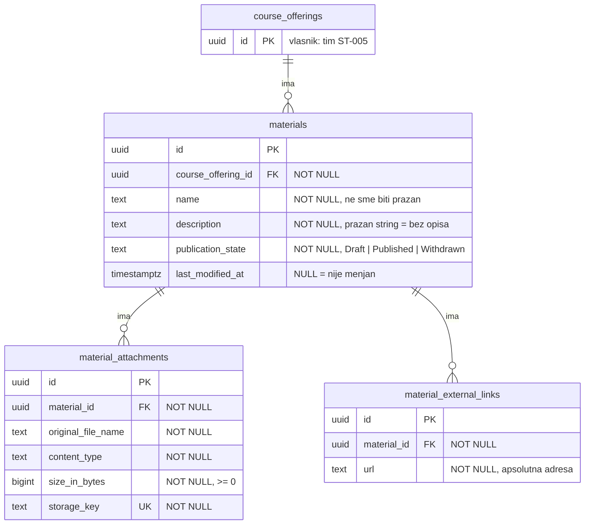

# ADR-0003: Relacioni model podataka nastavnih materijala

- **Status:** Predložen (nacrt za diskusiju u timu i sa timovima ST-001, ST-002 i ST-005)
- **Datum:** 2026-11-11
- **Vlasnici:** tim ST-009
- **Pogođene projektne celine:** ST-009; zavisi od ST-005 (izvođenje i angažovanje osoblja) i ST-001/ST-002 (korisnici i prijava); kasnije ST-010 (organizacija materijala)

## Kontekst

ST-009 traži da se za nastavni materijal čuvaju naziv, opis, izvođenje, stanje objave i lista priloga i veza. Za prilog se čuvaju izvorni naziv, tip i veličina, a spoljne veze su pune adrese.

Materijali se sada čuvaju samo u memoriji (`InMemoryMaterialRepository`, `InMemoryMaterialAttachmentRepository`) i nestaju pri gašenju aplikacije. `docs/architecture.md` traži ADR pre uvođenja baze i migracija. Ovaj nacrt opisuje deo modela za koji je odgovoran tim ST-009, kako bi bio spreman kada projekat izabere bazu.

**Ovaj ADR ne bira bazu ni alat za migracije.** To je zajednička odluka svih timova, jer materijal pokazuje na izvođenje (ST-005) koje vodi drugi tim. Ta odluka treba da bude poseban, zajednički ADR.

Postojeći domenski model koji tabele treba da prate:

- `Material`: `Id`, `CourseOfferingId`, `Name`, `Description`, `PublicationState`, `LastModifiedAt`
- `MaterialAttachment`: `Id`, `MaterialId`, `OriginalFileName`, `ContentType`, `SizeInBytes`, `StorageKey`
- `MaterialExternalLink`: `Id`, `MaterialId`, `Url`
- `MaterialPublicationState`: `Draft`, `Published`, `Withdrawn`

## Odluka

Predlaže se relacioni model sa tri tabele u vlasništvu tima ST-009. Nazivi su ilustrativni, u stilu Priloga A specifikacije.

### ER model

### Kardinaliteti

| Veza | Kardinalitet | Obrazloženje |
| --- | --- | --- |
| izvođenje → materijali | 1 : 0..N | Materijal pripada tačno jednom izvođenju (ne kataloškom predmetu); izvođenje može biti bez materijala. |
| materijal → prilozi | 1 : 0..N | Prilog pripada tačno jednom materijalu i nasleđuje njegovo pravo pristupa. |
| materijal → spoljne veze | 1 : 0..N | Veza pripada tačno jednom materijalu. |

### Ključevi i ograničenja

| Tabela | Ograničenje | Zašto |
| --- | --- | --- |
| sve | primarni ključ `id` (UUID) | Stabilan identitet; naziv nije ključ i može se menjati (US-02). UUID generiše aplikacija, kao i sada. |
| `materials` | FK `course_offering_id → course_offerings.id` | Referencijalni integritet; materijal ne može pokazivati na nepostojeće izvođenje. |
| `materials` | `CHECK (length(trim(name)) > 0)` | Druga linija odbrane za pravilo „naziv je obavezan”; prva je konstruktor `Material`. |
| `materials` | `CHECK (publication_state IN ('Draft','Published','Withdrawn'))` | Samo dozvoljena stanja. |
| `material_attachments` | FK `material_id → materials.id` | Prilog ne postoji bez materijala. |
| `material_attachments` | `CHECK (size_in_bytes >= 0)` | Isto pravilo kao u domenskom modelu. |
| `material_attachments` | `UNIQUE (storage_key)` | Jedan sadržaj na disku pripada tačno jednom prilogu (ADR-0001). |
| `material_external_links` | FK `material_id → materials.id` | Veza ne postoji bez materijala. |

Naziv materijala namerno **nije** jedinstven unutar izvođenja: dva materijala mogu se zvati „Vežbe”. Specifikacija ne traži jedinstvenost, a test `HandleAsync_CreatesDistinctMaterialsForSameName` to potvrđuje.

### Brisanje

Svi strani ključevi koriste `ON DELETE RESTRICT`, bez kaskadnog brisanja:

- Brisanje izvođenja ne sme tiho obrisati materijale drugog tima.
- Kaskadno brisanje priloga obrisalo bi red u bazi, ali **ne i datoteku na disku** (ADR-0001), pa bi ostale „siroče” datoteke. Brisanje priloga treba da ide kroz slučaj upotrebe koji briše i sadržaj (`IAttachmentFileStorage.DeleteAsync`).

### Stanje objave kao tekst

`publication_state` se čuva kao tekst (`'Draft'`), a ne kao broj iz enuma (`0`). Tekst je čitljiv u bazi i ne kvari se ako neko promeni redosled vrednosti u enumu.

### Indeksi

- `materials (course_offering_id)`: najčešći upit je „materijali ovog izvođenja”.
- `material_attachments (material_id)` i `material_external_links (material_id)`: učitavanje priloga i veza jednog materijala (`ListByMaterialAsync`).

Prema Prilogu A.4, ostale indekse birati tek na osnovu stvarnih upita.

### Transakcione granice

- **Kreiranje i izmena materijala:** jedan red, jedna transakcija.
- **Dodavanje priloga (US-06):** sadržaj se prvo čuva na disku, pa se upisuje red u `material_attachments`. Ako upis reda ne uspe, sadržaj se briše. Disk i baza ne mogu biti u istoj transakciji, pa ovaj kompenzacioni korak ostaje u slučaju upotrebe, kao i sada.
- **Objava materijala:** provera da svi prilozi imaju sačuvan sadržaj i promena `publication_state` treba da budu u istoj transakciji. Tako se poštuje pravilo „neispravan prenos ne ostavlja objavljen materijal sa nedostajućom datotekom”.

### Pravo pristupa

Strani ključ **ne predstavlja ovlašćenje** (Prilog A.4). To što materijal ima `course_offering_id` ne znači da ga korisnik sme menjati. Provera osoblja ostaje u slučajevima upotrebe (`IOfferingStaffChecker`), a provera članstva studenta pri čitanju je poseban zadatak.

### Način uvođenja

- Postojeći portovi (`IMaterialRepository`, `IMaterialAttachmentRepository`) se ne menjaju. Dodaju se nove implementacije nad bazom, a u `Program.cs` se menja samo registracija.
- Domenski model i handleri se ne menjaju.
- Memorijske implementacije ostaju za brze jedinične testove.

## Posledice

**Koristi:**
- Materijali preživljavaju restart aplikacije.
- Baza dodatno štiti pravila (prazan naziv, nepostojeće izvođenje, negativna veličina, dupli ključ sadržaja).
- Promena ne dira domen, handlere ni postojeće testove.

**Kompromisi i rizici:**
- `materials` zavisi od tabele `course_offerings` tima ST-005. Dok ona ne postoji, strani ključ se ne može napraviti. Redosled migracija mora se dogovoriti između timova.
- Pravila postoje i u domenu i u bazi; izmena pravila mora se uraditi na oba mesta.
- Disk i baza nisu u istoj transakciji; kompenzacija iz US-06 mora ostati.
- Kada ST-010 doda fascikle, `materials` će verovatno dobiti kolonu za fasciklu i redosled. To nije deo ovog nacrta.

**Potrebni testovi (integracioni, nad pravom bazom):**
- Upis i čitanje materijala sa svim poljima, uključujući `last_modified_at = NULL`.
- Odbijanje materijala sa nepostojećim izvođenjem (FK).
- Odbijanje praznog naziva i nepoznatog stanja (CHECK).
- Odbijanje dupliranog `storage_key`.
- Odbijanje brisanja materijala koji ima priloge (RESTRICT).
- Neuspeo upis priloga ne ostavlja ni red ni datoteku.
- Dva istovremena upisa istog materijala ne prave duplikat.

## Povezanost sa specifikacijom

- **Pogođeni zahtevi:** ST-009; zavisi od ST-005 i ST-001/ST-002; pripremno za ST-010.
- **Promena javnih ugovora i zavisnosti:** postojeći portovi se ne menjaju; dodaju se nove implementacije. Potreban je dogovor sa timom ST-005 o tabeli `course_offerings` i redosledu migracija.
- **Uticaj na čuvanje i migraciju podataka:** tri nove tabele. Postojeće stanje je samo u memoriji, pa nema podataka za prenos.
- **Testovi koji proveravaju odluku:** postojeći jedinični testovi (`MaterialTests`, `CreateMaterialHandlerTests`, `UpdateMaterialDetailsHandlerTests`, `AttachFileToMaterialHandlerTests`) i novi integracioni testovi navedeni gore.

## Razmotrene alternative

- **Prilozi i veze kao JSON kolona u `materials`:** jednostavnije, ali bez stranih ključeva, bez `UNIQUE (storage_key)` i teže za upite po prilogu. Odbijeno.
- **`publication_state` kao broj:** manje prostora, ali nečitljivo i osetljivo na promenu redosleda u enumu. Odbijeno.
- **Kaskadno brisanje priloga i veza:** jednostavnije, ali ostavlja datoteke na disku bez reda u bazi i može tiho obrisati podatke. Odbijeno.
- **Zasebna baza samo za ST-009:** brže za naš tim, ali bez stranog ključa ka izvođenju i bez zajedničkih transakcija sa drugim modulima. Odbijeno.

## Otvorena pitanja za tim

1. Koju bazu i koji alat za migracije projekat koristi (zajednički ADR)? Ko je zadužen?
2. Kada će tim ST-005 imati tabelu `course_offerings` i kako se usklađuje redosled migracija?
3. Da li treba čuvati autora i vreme kreiranja materijala? ST-009 to ne navodi (za razliku od ST-008), pa nije predloženo.
4. Da li je potrebno ograničenje dužine naziva, opisa i adrese? Specifikacija ga ne navodi.
5. Da li ista adresa sme dva puta u istom materijalu (`UNIQUE (material_id, url)`)?
6. Da li povučen materijal ostaje u bazi (meko stanje `Withdrawn`) ili se ikada briše?
7. Kako se izvode integracioni testovi nad bazom u CI-ju (`.github/workflows/dotnet.yml`)?
