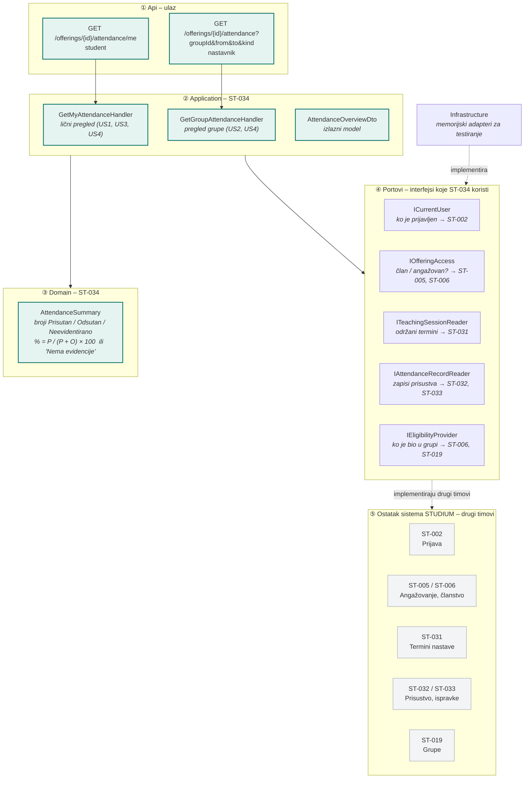

# ST-034 Pregled prisustva studenta – arhitektura

Dijagram prikazuje komponente ST-034, njihove odgovornosti, interfejse (portove) i veze sa ostatkom sistema STUDIUM.

## Komponente i odgovornosti

| Komponenta | Sloj | Odgovornost |
| --- | --- | --- |
| `GET /offerings/{id}/attendance/me` | Api | Ulaz za studenta; identitet se uzima iz prijave |
| `GET /offerings/{id}/attendance` | Api | Ulaz za nastavnika; filteri grupa, period, vrsta nastave |
| `GetMyAttendanceHandler` | Application | Lični pregled: provera članstva, izbor podobnih održanih termina, sastavljanje pregleda |
| `GetGroupAttendanceHandler` | Application | Pregled grupe: provera angažovanja, filteri, pregled po studentu |
| `AttendanceOverviewDto` | Application | Izlazni model: termini sa stanjem, brojevi, procenat ili „Nema evidencije“ |
| `AttendanceSummary` | Domain | Brojanje stanja i računanje procenta P / (P + O) × 100, dve decimale, polovina naviše |

## Portovi i vlasnici

| Port | Šta daje | Izvor (drugi tim) |
| --- | --- | --- |
| `ICurrentUser` | Identitet prijavljenog korisnika | ST-002 |
| `IOfferingAccess` | Da li je korisnik član ili angažovan na izvođenju | ST-005, ST-006 |
| `ITeachingSessionReader` | Održani i otkazani termini izvođenja | ST-031 (`TeachingSession`) |
| `IAttendanceRecordReader` | Zapisi prisustva po terminu | ST-032, ST-033 (`AttendanceRecord`) |
| `IEligibilityProvider` | Podobni studenti za termin u vreme održavanja | ST-006, ST-019 |

Dok drugi timovi ne završe svoje delove, portove implementiraju memorijski adapteri u `Infrastructure`.
