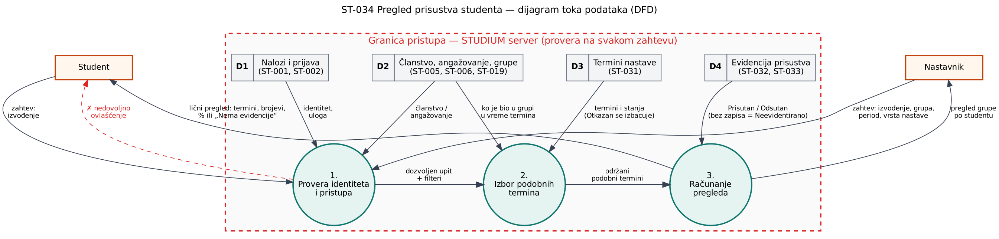

# ST-034 Pregled prisustva studenta – dijagram toka podataka (DFD)

Izvor dijagrama: `st-034-dfd.dot` (Graphviz: `dot -Tpng st-034-dfd.dot -o st-034-dfd.png`).

## Akteri

| Akter | Ulaz | Izlaz |
| --- | --- | --- |
| Student | Izvođenje predmeta | Lični pregled: održani termini sa stanjem, brojevi Prisutan / Odsutan / Neevidentirano, procenat ili „Nema evidencije“ |
| Nastavnik | Izvođenje, grupa, period, vrsta nastave | Pregled grupe po studentu |

## Procesi

| Proces | Šta radi |
| --- | --- |
| 1. Provera identiteta i pristupa | Identitet se uzima iz prijave. Student mora biti član izvođenja i vidi samo sebe; nastavnik mora biti angažovan na izvođenju. Inače: nedovoljno ovlašćenje, bez podataka. |
| 2. Izbor podobnih termina | Uzima termine izvođenja, izbacuje otkazane i primenjuje filtere; zadržava termine u kojima je student bio član ciljne grupe u vreme termina. |
| 3. Računanje pregleda | Za svaki termin čita stanje; bez zapisa je Neevidentirano. Procenat = Prisutan / (Prisutan + Odsutan) × 100, najviše dve decimale, polovina naviše. Bez Prisutan i Odsutan: „Nema evidencije“. |

## Skladišta podataka (vlasnici: drugi timovi, ST-034 ih samo čita)

| Skladište | Sadržaj | Zahtevi |
| --- | --- | --- |
| D1 Nalozi i prijava | Identitet i uloga korisnika | ST-001, ST-002 |
| D2 Članstvo, angažovanje, grupe | Članstvo studenta, angažovanje osoblja, pripadnost grupi kroz vreme | ST-005, ST-006, ST-019 |
| D3 Termini nastave | Termini i njihova stanja (Planiran / Održan / Otkazan) | ST-031 |
| D4 Evidencija prisustva | Zapisi Prisutan / Odsutan i odobrene ispravke | ST-032, ST-033 |

## Granica pristupa

Sva skladišta i procesi su unutar servera. Provera iz procesa 1 izvršava se na svakom zahtevu, uključujući direktan poziv API-ja; skrivanje dugmeta u interfejsu nije zaštita. ST-034 ne upisuje podatke ni u jedno skladište.
