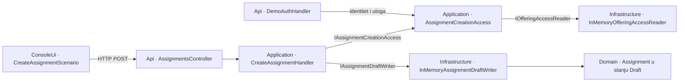
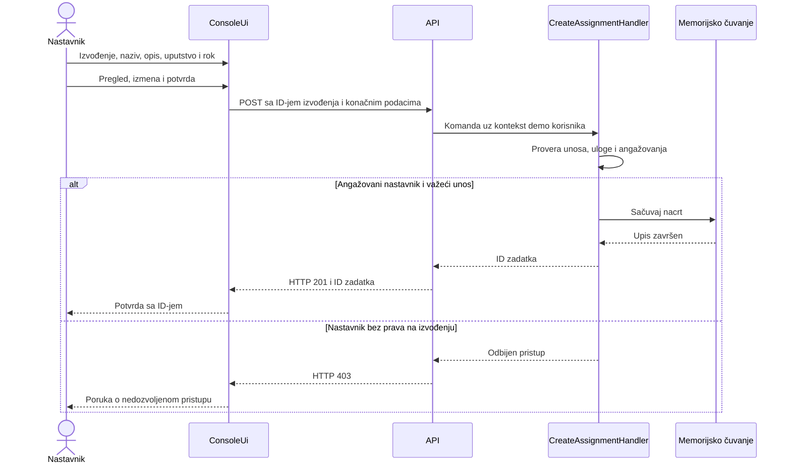

# ST-011 / US-01 — Kreiranje individualnog zadatka za KT2

Ovaj detalj dopunjuje [dijagram arhitekture tima 14](arhitektura-sistema.png) i razrađuje deo procesa 1 iz [dijagrama toka podataka](tok-podataka.png). [Pokretanje i koraci demonstracije](../../README.md#kt2-scenario-st-011--us-01)

## Arhitektura

## Tok podataka

